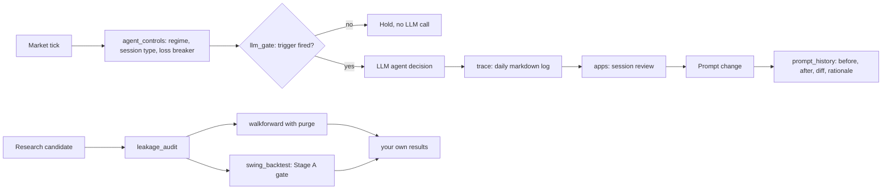

# llm-trading-lab

Tooling for measuring, constraining and logging LLM trading agents.

## Not investment advice

This repository is research tooling. It contains no trading strategy and no live prompts, and
nothing in it is a recommendation to buy or sell a security or an option. Backtest, replay and synthetic results
do not predict future results. A bought option can lose its full premium.

## What it does

- Decides per tick whether an LLM agent needs to be called at all, and holds without a call
  when no trigger fires (`src/agent_controls/llm_gate.py`). Regime, session type, a daily loss
  breaker and a markdown trace of every LLM call sit beside it.
- Gates a trade setup family on expectancy with a two-month-block bootstrap, a recent-years
  check and a matched control (`src/swing_backtest/stats.py`), next to an 8-check portfolio
  risk engine (`src/swing_backtest/risk.py`).
- Runs session-aligned walk-forward folds with an optional purge of label-overlapping rows
  (`src/walkforward/`).
- Audits a feature set for look-ahead leaks: correlation screen, truncation test, fold overlap
  and triple-barrier class balance by year (`src/leakage_audit/`).
- Records each prompt change as before, after, diff and rationale with a falsification test,
  and measures how closely a change log follows that convention (`src/prompt_history/`).
- Replays an agent session in two browser review apps built on a synthetic sample session
  (`apps/`).

## How it works



The live loop is deterministic until a trigger fires. `llm_gate` sorts its triggers into strong
and weak. A strong trigger (open position, conviction at the entry threshold, ML probability
outside its band, regime change, squeeze fired, thesis weakened or invalidated) causes a call
on its own. A weak trigger (conviction in the watch band, trendline breakout, pullback, new
session trend) causes a call only together with a strong trigger or a second weak one. With
no trigger the gate returns a hold and no LLM call is made. Every call that is made is written to a daily markdown trace with its prompt name,
payload, raw response, parsed result and token usage. The review apps read those traces with
the tick, scenario and order logs and show them on the price chart. When a session review
leads to a prompt change, `prompt_history` stores the old and new text, the diff and a
rationale that names the trigger, the expected behavior change and the observation that would
show the change was wrong.

Research candidates go through the leakage audit before any gate. The Stage A gate measures
expectancy only: on synthetic data an entry family that peeks five bars ahead passes it
(`python -m swing_backtest.demo`), which is why the leakage audit is a separate step.

## Results

This repository publishes no result tables. Earlier revisions carried tables exported from
private research runs on vendor data. The redistribution rights for that data are not
recorded, so the tables and the charts built from them were removed from the repository and
its history pending confirmation by the owner. `data/results/README.md` describes what the
directory holds now.

Results are regenerated by running the included scripts against your own data source:

- `python -m swing_backtest.demo` runs the Stage A gate on synthetic data.
- `python -m leakage_audit --data <bars file>` audits a feature set for look-ahead leaks.
- `python -m walkforward --data <bars file> --purge-bars 10` runs session-aligned walk-forward
  folds.
- `python -m prompt_history index` measures a prompt change log against the record convention.
- `scripts/build_chart_data.py` (standard library only) builds
  `docs/data.json` from CSV tables placed in `data/results/` with the column
  names the script reads. Neither the tables nor the exporters for them are included.

`src/leakage_audit/patterns.py` reproduces two look-ahead patterns with their fixes: a
five-minute resample with `transform("last")` that gives each bar its bucket's closing value,
and a daily index close joined on the bar's date. On the synthetic sample,
`python -m leakage_audit --plant-leaks` flags only the bucket leak in the correlation screen
(|r| = 0.6370) and flags both in the truncation test; the same-day merge leak stays under the
0.15 correlation threshold.

## Quickstart

Python 3.11 or later. All data is synthetic; no market data or credentials are needed.

```bash
git clone https://github.com/darblinko/llm-trading-lab
cd llm-trading-lab
python3 -m venv .venv
. .venv/bin/activate
pip install -e ".[dev]"
python scripts/make_sample_data.py
python -m pytest -q
python -m swing_backtest.demo
python -m leakage_audit --data data/sample/bars_1min.csv --plant-leaks
python -m leakage_audit --data data/sample/bars_1min.csv --purge-bars 10
python -m walkforward --data data/sample/bars_1min.csv --purge-bars 10
python -m prompt_history validate --root examples/prompt_history/records --changelog examples/prompt_history/CHANGELOG.md
```

`make_sample_data.py` writes 17,550 one-minute bars over 45 sessions of a random walk.
`swing_backtest.demo` prints a FAIL for 519 random entries (mean R -0.035) and a PASS for 486
entries that peek five bars ahead (mean R 0.749). The planted-leak audit reports a leak and 10
overlapping rows per fold; the purged run reports none. The walk-forward run trains 3 folds and
reports a mean AUC of 0.5070 on the random walk. These figures are the command output at seed 0.

Optional xgboost model: `pip install -e ".[xgboost]"`, then `--model xgboost`.

Configuration is read from environment variables only; `.env.example` lists them. The risk
engine reads `RISK_*` (`src/swing_backtest/config.py`). The review apps read
`ALPACA_API_KEY` and `ALPACA_API_SECRET` when set and otherwise run offline on the sample
session. Each app has its own README with run and test commands.

## Project layout

```text
src/agent_controls/      LLM call gate, session type, regime, daily loss breaker, call trace
src/swing_backtest/      Stage A gate statistics, 8-check risk engine, synthetic gate demo
src/walkforward/         Session-aligned folds with purge, OHLCV features, models, runner
src/leakage_audit/       Correlation screen, truncation test, fold overlap, barrier balance
src/prompt_history/      Change records, validator, changelog parser, compliance index
apps/                    Two session review apps and the synthetic sample session they read
data/results/            Placeholder; no result tables are committed (see data/results/README.md)
data/sample/             Synthetic bars written by scripts/make_sample_data.py (not committed)
docs/                    Landing page; build_chart_data.py writes data.json here
examples/prompt_history/ One fictional prompt change record and changelog entry
scripts/                 make_sample_data.py, build_chart_data.py
tests/                   One directory per package
```

## Design decisions and limitations

- No result tables are committed. The code runs on synthetic data in this repository; run it
  against your own data source to produce results.
- `src/walkforward` computes features from OHLCV, not from precomputed indicator columns.
- The Stage A gate does not detect look-ahead; the synthetic demo shows a peeking family
  passing it. The correlation screen does not catch the same-day merge leak; the truncation
  test does.
- The live prompts, the LLM pipeline and the order execution code are not included.
  `prompt_history` publishes the record structure and the validator, not prompt text; the
  example record is fictional.
- `llm_gate` changes over time (`REGIME_CHANGE_WINDOW_TICKS` in
  `src/agent_controls/llm_gate.py`); a replay result applies to the gate revision it ran on.

## License

Apache-2.0. See `LICENSE`.
